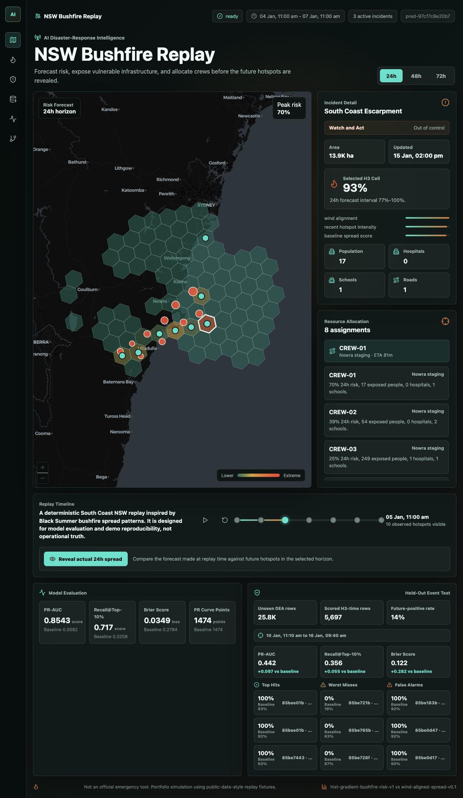
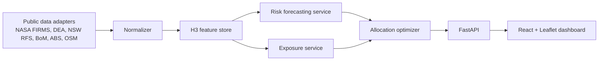

# AI Disaster-Response Intelligence System



An Australian bushfire intelligence platform that hides the future, forecasts 24/48/72-hour hotspot risk on H3 cells, reveals the actual fire progression, and recommends where limited response resources should go.

This is built to look and feel like a serious ML Engineering system, not a notebook demo: real public hotspot data, leakage-safe temporal labels, a trained model artifact, a held-out event benchmark, FastAPI contracts, and a React/Leaflet command dashboard.

> Portfolio/demo system only. This is not an official emergency-response tool and must not be used for operational decisions.

## Quick Demo

```bash
make demo
```

Then open `http://127.0.0.1:5173` if your browser does not open automatically.

Demo flow:

1. Switch between 24/48/72-hour horizons.
2. Inspect predicted high-risk H3 cells and exposed assets.
3. Click `Reveal actual 24h spread` to compare forecasted cells with future hotspots.
4. Read the held-out event panel: model lift, misses, false alarms, and top hits.
5. Inspect resource allocation recommendations for crews and supplies.

## Free HTTPS Deployment

The repo includes a Vercel deployment path for a public read-only demo:

- Current public demo: https://ideas-mauve.vercel.app
- Static dashboard is built from `frontend/`.
- FastAPI is served from `api/index.py` under `/api`.
- The frontend build uses `VITE_API_BASE_URL=/api`, so the deployed app runs from one HTTPS origin.

```bash
vercel login
vercel --prod
```

Keep `DISASTER_INTEL_MODE=demo` for the public deployment unless you intentionally wire live feeds and rate limits.

## Recruiter Signal

- **Real data:** trained on a `13,586`-row, five-state Digital Earth Australia hotspot corpus, enriched with `1,656` Bureau of Meteorology station-day observations and `10,247` ABS population-grid H3 cells, then evaluated on `25,800` unseen held-out rows.
- **Temporal ML:** labels each H3 cell positive only if a hotspot appears in the future horizon, with lookback-only features to prevent leakage.
- **Geospatial system design:** H3 indexing, spread baseline, ABS population-grid aggregation, weather joins, exposure overlays, infrastructure scoring, and map-ready GeoJSON outputs.
- **Model evaluation:** PR-AUC, Recall@Top-10%, Brier score, calibration bins, and prediction-vs-actual failure analysis.
- **Production shape:** FastAPI service, typed API contracts, reproducible scripts, Docker Compose, tests, and a React/Leaflet dashboard.
- **Decision layer:** resource allocation ranks cells by risk, exposed population, infrastructure weight, and distance constraints.

## Known Scope

This project is intentionally a portfolio-grade ML engineering demo, not an operational emergency platform. The default path is fully local and reproducible; heavier production-style pieces are optional so a recruiter can clone and run the project quickly.

- Default model artifact: scikit-learn `HistGradientBoostingClassifier`.
- Optional model family: XGBoost via `make install-optional` and `make train-xgboost`.
- Default exposure layer: ABS population grid aggregated to H3 cells, with deterministic fallback for cells outside the committed sample.
- Optional exposure overlay: OpenStreetMap infrastructure extract via `make download-osm`.
- Default allocation solver: deterministic greedy optimizer.
- Optional allocation solver: OR-Tools CP-SAT when `backend/requirements-optional.txt` is installed.
- Weather: Bureau of Meteorology daily station observations are joined by nearest station and last completed observation day; this is historical weather context, not a live BoM forecast integration.
- Database: PostGIS schema and Docker Compose are included, while the default demo serves from local fixtures and artifacts.

## Results At A Glance

| Evaluation | Model PR-AUC | Baseline PR-AUC | Model Recall@Top-10% | Baseline Recall@Top-10% | Model Brier | Baseline Brier |
| --- | ---: | ---: | ---: | ---: | ---: | ---: |
| Multi-state temporal split | 0.2625 | 0.0493 | 0.5829 | 0.2193 | 0.0240 | 0.4872 |
| Held-out NSW window, Jan 10-16 2020 | 0.5229 | 0.3580 | 0.4402 | 0.3035 | 0.1116 | 0.4028 |

## National Model Benchmark

The repository includes a trained artifact from a bounded `13,586`-row DEA hotspot corpus covering selected windows in NSW, VIC, QLD, SA, and WA from November 2019 through January 2020. The feature builder expands those observations into `23,790` temporal H3 training examples across 24/48/72-hour prediction horizons, with real BoM weather and ABS H3 population features.

| Metric | Trained model | Wind-aligned baseline |
| --- | ---: | ---: |
| PR-AUC | 0.2625 | 0.0493 |
| Recall@Top-10% | 0.5829 | 0.2193 |
| Brier Score | 0.0240 | 0.4872 |

Artifacts:

- `backend/app/data/multiseason_national_hotspots_sample.csv`
- `backend/app/data/multiseason_national_manifest.json`
- `backend/app/data/bom_weather_observations_sample.csv`
- `backend/app/data/abs_population_h3_sample.csv`
- `backend/app/data/historical_hotspots_sample.csv`
- `backend/app/ml/artifacts/bushfire_risk_model.joblib`
- `backend/app/ml/artifacts/training_dataset.csv`
- `backend/app/ml/artifacts/metrics.json`

## Held-Out Event Benchmark

The frozen model is also scored on an unseen DEA hotspot window from January 10-16, 2020 across a wider NSW bbox. This produces `5,646` H3-time examples from `25,800` raw hotspot rows.

| Metric | Frozen model | Wind-aligned baseline |
| --- | ---: | ---: |
| PR-AUC | 0.5229 | 0.3580 |
| Recall@Top-10% | 0.4402 | 0.3035 |
| Brier Score | 0.1116 | 0.4028 |

Held-out artifacts:

- `backend/app/data/heldout_hotspots_sample.csv`
- `backend/app/ml/artifacts/heldout_dataset.csv`
- `backend/app/ml/artifacts/heldout_predictions.csv`
- `backend/app/ml/artifacts/heldout_metrics.json`
- `backend/app/ml/artifacts/heldout_failure_analysis.json`

## Architecture



## Local Development

First run:

```bash
make install
make demo
```

Useful commands:

| Command | Purpose |
| --- | --- |
| `make demo` | Start FastAPI and Vite, then open the dashboard. |
| `make backend` | Run only the FastAPI backend at `127.0.0.1:8000`. |
| `make frontend` | Run only the React dashboard at `127.0.0.1:5173`. |
| `make train` | Rebuild the trained model artifact from the historical hotspot sample. |
| `make train-xgboost` | Rebuild the model with optional XGBoost after `make install-optional`. |
| `make train-national` | Train against the bounded multi-state, multi-season DEA hotspot corpus. |
| `make evaluate-heldout` | Score the frozen model on the held-out event window. |
| `make download-bom` | Download real BoM daily station weather observations for feature joins. |
| `make download-abs-population` | Aggregate the ABS Australian Population Grid GeoTIFF to H3 cells. |
| `make build-multiseason-corpus` | Download bounded DEA hotspot windows across NSW, VIC, QLD, SA, and WA. |
| `make download-osm` | Download optional OpenStreetMap infrastructure overlays for exposure scoring. |
| `make install-optional` | Install XGBoost and OR-Tools extras. |
| `make test` | Run backend unit/API/model-contract tests. |
| `make build` | Build the frontend production bundle. |
| `make check` | Run backend tests and frontend build. |

Manual backend/frontend commands still work if you prefer to run services in separate terminals:

```bash
PYTHONPATH=backend .venv/bin/uvicorn app.main:app --reload --host 127.0.0.1 --port 8000
npm --prefix frontend run dev -- --host 127.0.0.1 --port 5173
```

Docker services are defined in `docker-compose.yml`. The backend can run without PostGIS for the deterministic replay, while PostGIS is included to show the intended production storage path.

## Reproduce The Model

Download the historical DEA sample:

```bash
PYTHONPATH=backend .venv/bin/python backend/scripts/download_dea_hotspots.py \
  --start 2020-01-04T00:00:00Z \
  --end 2020-01-10T00:00:00Z \
  --state NSW \
  --bbox 149.4,-36.8,151.8,-33.8 \
  --out backend/app/data/historical_hotspots_sample.csv \
  --page-size 2000 \
  --max-records 20000 \
  --chunk-hours 6
```

Train and benchmark:

```bash
PYTHONPATH=backend .venv/bin/python backend/scripts/train_bushfire_model.py \
  --input backend/app/data/historical_hotspots_sample.csv \
  --output-dir backend/app/ml/artifacts \
  --dataset-out backend/app/ml/artifacts/training_dataset.csv
```

The API automatically loads `backend/app/ml/artifacts/bushfire_risk_model.joblib` when it exists and falls back to the deterministic scorer otherwise.

Build the national-ready corpus and real-data overlays:

```bash
make download-bom
make download-abs-population
make build-multiseason-corpus
make train-national
```

This path uses selected DEA hotspot windows across NSW, VIC, QLD, SA, and WA, real BoM station observations from November 2019 through January 2020, and the ABS population grid aggregated to H3 resolution 5.

Download and score the held-out window:

```bash
PYTHONPATH=backend .venv/bin/python backend/scripts/download_dea_hotspots.py \
  --start 2020-01-10T00:00:00Z \
  --end 2020-01-16T00:00:00Z \
  --state NSW \
  --bbox 148.7,-37.4,153.8,-31.1 \
  --out backend/app/data/heldout_hotspots_sample.csv \
  --page-size 5000 \
  --max-records 60000 \
  --chunk-hours 6

PYTHONPATH=backend .venv/bin/python backend/scripts/evaluate_heldout_model.py \
  --input backend/app/data/heldout_hotspots_sample.csv \
  --lookback-hours 36 \
  --step-hours 12 \
  --candidate-ring 3
```

## CV Bullets

**ML Engineer**

- Built an AI disaster-response intelligence system for Australian bushfires using Python, FastAPI, H3, scikit-learn, and React/Leaflet; trained 24/48/72-hour geospatial risk models on a five-state `13,586`-row Digital Earth Australia hotspot corpus enriched with BoM weather and ABS population-grid features, then validated on a `25,800`-row held-out NSW event window.

**Data Scientist / Applied ML**

- Designed a leakage-safe bushfire forecasting pipeline that labels future hotspot emergence by H3 cell and timestamp; improved multi-state temporal-split PR-AUC from `0.0493` to `0.2625` and held-out-window PR-AUC from `0.3580` to `0.5229` over a wind-aligned spread baseline, with Brier score and Recall@Top-10% reporting.

**Full-Stack ML / Product Engineering**

- Shipped an end-to-end disaster-response dashboard that replays a historical bushfire, hides future observations, forecasts spread, reveals actual hotspots, maps hits/misses/false alarms, estimates exposed population and infrastructure, and recommends resource allocations under capacity and distance constraints.

**Short Version**

- Built a geospatial ML disaster-response platform that forecasts Australian bushfire risk on H3 cells, validates on held-out public hotspot data, and ships an interactive prediction-vs-actual replay dashboard with allocation recommendations.

## Public Data Anchors

- NASA FIRMS wildfire hotspots
- Digital Earth Australia Hotspots
- NSW RFS public incident feeds
- Bureau of Meteorology fire-weather context
- ABS population grid / Digital Atlas
- OpenStreetMap / Overpass infrastructure data

See [Data Sources And Licenses](docs/data-sources-and-licenses.md) for attribution, redistribution notes, and publication caveats.

## Public Release

Before switching the repository to public, run:

```bash
make check
```

Then review [Public Release Checklist](docs/public-release-checklist.md). The committed demo data is small and public-data-derived, `.env` files are ignored, and the root project code is released under the [MIT License](LICENSE).
