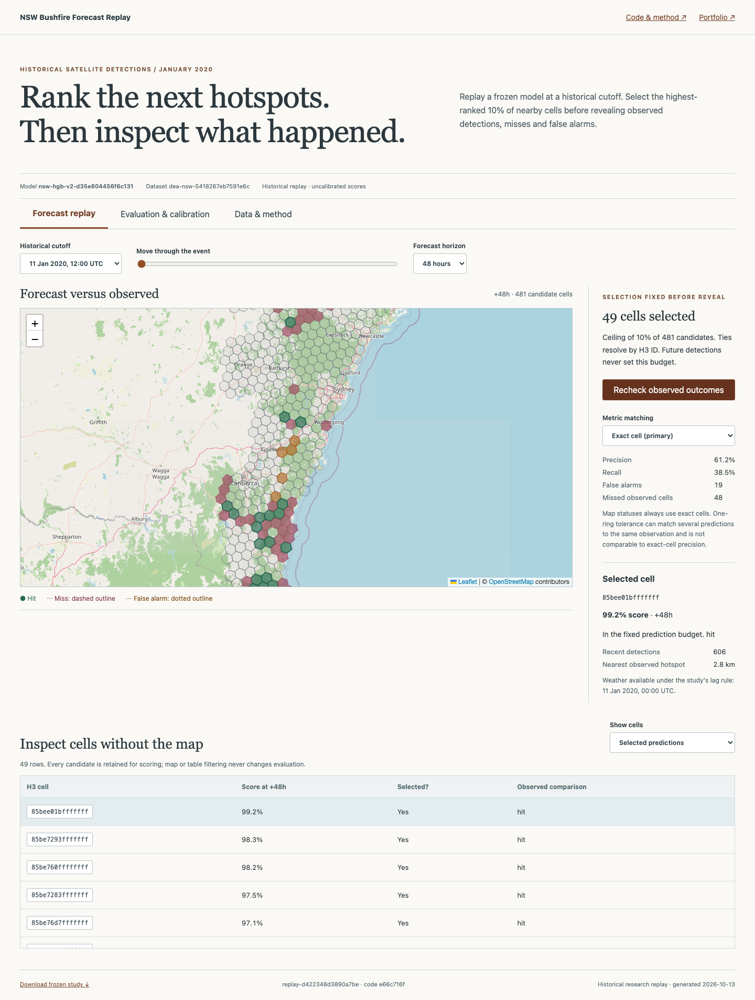

# NSW Bushfire Forecast Replay

**Can a model rank future satellite hotspot cells better than simple baselines using only observations available at a historical cutoff?**

[Open the historical replay](https://disaster.m21264551.com) · [Case study](docs/case-study.md)



## Try it

Select a January 2020 cutoff and a 24/48/72-hour horizon. Inspect the fixed highest-ranked 10% of candidates, then reveal observed hits, misses and false alarms. Change the horizon: the selected-cell score, map, table and reveal state change together. Late cutoffs disable horizons without future observation coverage. The table provides a keyboard alternative to the map.

**Evaluation & calibration** compares the exact frozen model with persistence, training prevalence and a fixed-bearing spread heuristic. The target is satellite hotspot occurrence, not a physical fire-spread simulator, fire perimeter or emergency response recommendation.

## Real data and coverage

The new public replay uses complete paginated [Digital Earth Australia Hotspots](https://hotspots.dea.ga.gov.au/) archive queries for a fixed NSW bounding box `[148.7, -37.4, 153.8, -31.1]`:

- Training archive: January 4–10, 2020 (exclusive end), **58,007 detections**.
- Reserved event archive: January 10–16, 2020 (exclusive end), **26,129 detections**.

Each CSV has a receipt recording retrieval time, source, query interval, bounding box, matched/downloaded counts for every six-hour chunk, and SHA256. Pagination or checksum failures prevent publication. This replaces the earlier truncated “multi-season” samples, some of which contained less than one day of data despite six-day window labels. January 10–16 remains an **existing benchmark**, not newly unseen evidence; the complete re-acquisition also includes records missing from the earlier download.

The real BoM daily weather snapshot is retained. Raw intensity is excluded because the earlier downloader mixed radiative power and temperature. No population, fabricated infrastructure, allocation, confidence offsets or incident statuses enter the public model or interface.

## Experimental protocol

1. Define candidates identically for training and replay: H3 resolution 5, ring 3 around detections from the preceding 36 hours, with centres inside the fixed NSW bounds and land mask.
2. Build features only after filtering observations to the cutoff. Use local/neighbour counts, distance, local recency, horizon, the spread heuristic and four actual BoM weather fields plus station distance/age.
3. Treat daily weather as available at 00:00 UTC two days after its date. This conservative lag is an explicit assumption; historical publication timestamps are unavailable. Missing weather remains NaN for the model.
4. Keep complete cutoff groups together and purge training cutoffs whose maximum 72-hour outcome window reaches the January 10 evaluation boundary. The model trains on **4,527 cell/horizon rows from three complete cutoffs**; its latest training outcome ends January 9 at 12:00 UTC.
5. Fit histogram gradient boosting with fixed settings: 150 iterations, learning rate 0.055, 15 leaves, L2=0.1, seed 42, no random early-stopping validation or event-based tuning.
6. Reload that serialized model and generate every public frame from it. Every frame carries matching dataset/model/candidate identities.
7. Score all candidates. Select `ceil(0.10 × candidate count)` in descending score order, resolving ties by H3 ID **before** reading outcomes. Display filters never affect metrics.
8. Reveal exact-cell outcomes by default. One-ring matching is a separately labelled secondary metric; the map's statuses stay exact.

Recall includes observed cells outside the candidate area. AP and Brier evaluate all candidates. Metrics pool covered cutoff rows per horizon; overlapping windows reuse observations and are not independent events. Scores are uncalibrated. Calibration is measured, not fitted, on this event.

## Reproduced result, including failure

| Horizon | Model AP | Persistence AP | Spread heuristic AP | Model Brier | Spread Brier |
|---|---:|---:|---:|---:|---:|
| 24h | 0.561 | 0.438 | 0.596 | 0.100 | 0.190 |
| 48h | 0.562 | 0.481 | 0.626 | 0.142 | 0.303 |
| 72h | 0.549 | 0.507 | 0.650 | 0.179 | 0.385 |

The heuristic ranks better on this event. The model's score magnitudes have better Brier loss than that heuristic, while persistence has better Brier at 72 hours. At a fixed 10% budget the model still misses many observed cells. These results are shown without claiming an operationally useful forecaster.

## Architecture and API

`backend/app/replay/pipeline.py` owns candidate construction, cutoffs, features, fitting, scoring and export. `artifacts/model.joblib` is the frozen trained model; `replay-v2.json` is its complete saved output. The API does not deserialize the model or perform inference; it checks its SHA256 against the bundle and verifies frame identities and the selection policy. Missing or mismatched artifacts return 503. Stale client artifact requests return 409.

Public schema v2:

- `GET /api/v2/study`: provenance, coverage, frame availability and shared benchmarks.
- `POST /api/dashboard/frame` or `/api/predict`: `{frame_id, artifact_id}`; returns all scores without future outcomes.
- `POST /api/reveal`: same fields plus optional `tolerance_rings` (0 or 1).
- `GET /api/metrics/{artifact_id}`: matching benchmark results.
- `GET /api/v2/download`: complete frozen experiment.
- `GET /api/health`: model/data readiness and identities.

Allocation and current-incident routes are retired from the public contract. `app/legacy_demo.py` and older services remain an **unserved regression harness** for existing fixtures; the production entrypoint never imports or mounts them. React uses AbortController and generation checks to reject late frame/reveal responses. Cell selection is keyed by H3 ID and horizon.

## Setup, reproduction and checks

Python 3.11 and Node 20:

```sh
python3 -m venv .venv
.venv/bin/pip install -r backend/requirements.txt
npm --prefix frontend ci
make replay                 # regenerate from committed snapshots, no network needed
make test
make build
cd frontend
npx playwright install chromium
PYTHON=../.venv/bin/python npm run test:browser
```

For local browsing, run `PYTHONPATH=.:backend .venv/bin/python -m uvicorn api.index:app --port 8008`, then `npm --prefix frontend run dev`. Vite proxies `/api` to that server.

Optional explicit archive refresh:

```sh
PYTHONPATH=backend .venv/bin/python backend/scripts/download_replay_corpus.py \
  --start 2020-01-04T00:00:00Z --end 2020-01-10T00:00:00Z \
  --out backend/app/data/replay_training_dea.csv
PYTHONPATH=backend .venv/bin/python backend/scripts/download_replay_corpus.py \
  --start 2020-01-10T00:00:00Z --end 2020-01-16T00:00:00Z \
  --out backend/app/data/replay_evaluation_dea.csv
make replay
```

Deploy code and matching frozen artifacts together. Prior Git revisions retain the old code/data/model for rollback. Existing Vercel/custom-domain hosting remains.

Tests cover timestamp-group isolation and embargo, future-observation independence, weather cutoff rules, outcome-independent budgets, serialized-model score reproduction, artifact mismatch rejection, coverage states, public route retirement, horizon selection and stale-response rejection. Existing download, land-mask and security tests remain. The previous backend collection failure is fixed by invoking `PYTHONPATH=.:backend python -m pytest`, which makes `api.index` importable without weakening assertions.

## Limits

One training week and one adjacent event are insufficient for geographic or seasonal generalization. Three training cutoffs are strongly dependent. Archive completeness means complete responses to those queries, not complete physical fire observation: sensors, cloud cover and catalogue revisions affect detections. Zero recorded hotspots is not proof of no fire. The fixed-bearing spread baseline is not a wind forecast. Historical weather release timing is approximated. This is a reproducible inspection tool with explicit failure analysis, not an operations console.
